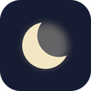
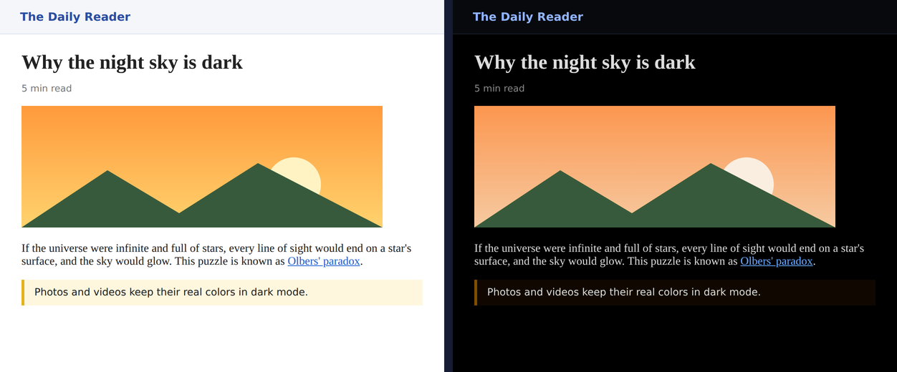
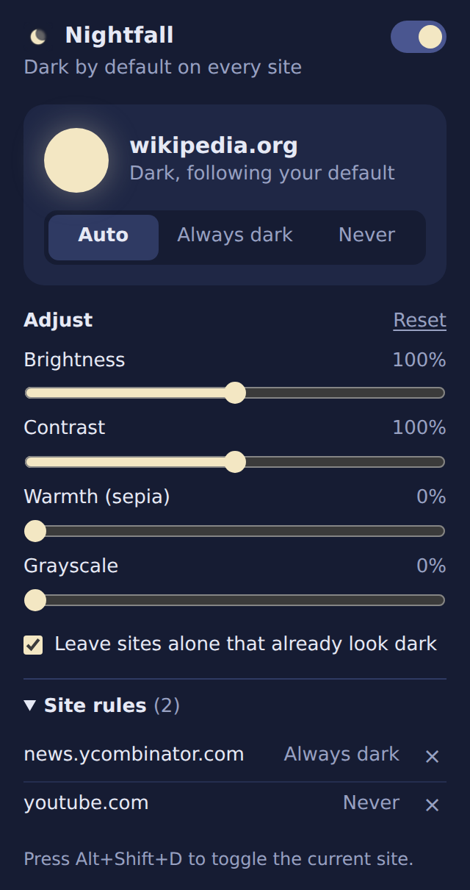

<div align="center">



# Nightfall Dark Mode

A lightweight browser extension that turns any website dark, with per-site rules and simple controls for brightness, contrast, warmth and grayscale.


</div>



## Features

- **Dark mode everywhere.** Every site turns dark by default, and a single switch turns the default off.
- **Per-site rules.** Set any site to *Auto*, *Always dark* or *Never*, and review or remove your rules from the popup.
- **Adjustments with live preview.** Brightness, contrast, warmth (sepia) and grayscale sliders update open pages as you drag.
- **Smart skipping.** Sites that already have a dark design are detected and left alone (you can turn this off).
- **Media stays natural.** Images, videos, canvases and embedded frames keep their real colors, and fullscreen videos are shown untouched.
- **Keyboard shortcut.** Press <kbd>Alt</kbd>+<kbd>Shift</kbd>+<kbd>D</kbd> to toggle the current site.
- **Private by design.** No network requests, no analytics, no accounts. Settings are stored locally in your browser.
- **No dependencies.** Plain JavaScript, HTML and CSS; nothing to build.

<p align="center"></p>

The moon in the popup shows the state of the current site: a full moon means dark mode is on, a crescent means it's off.

## Installation

Nightfall isn't on an extension store yet, so you load it directly from this repository.

### Chrome, Edge, Brave, Opera

1. Download the code: click **Code → Download ZIP** on this page and unzip it, or clone it:
   ```bash
   git clone https://github.com/<your-username>/nightfall-dark-mode.git
   ```
2. Open the extensions page: `chrome://extensions` (Edge: `edge://extensions`, Brave: `brave://extensions`).
3. Turn on **Developer mode**.
4. Click **Load unpacked** and select the **`extension`** folder inside this repository.
5. Pin Nightfall from the puzzle-piece menu so the moon icon stays in your toolbar.
6. Reload any tabs that were open before installing.

Keep the folder where it is after loading it, since the browser runs the extension from that location.

### Firefox

Firefox runs Manifest V3 background code as a script rather than a service worker, so two small edits are needed:

1. In `extension/manifest.json`, replace
   ```json
   "background": { "service_worker": "background.js" }
   ```
   with
   ```json
   "background": { "scripts": ["shared.js", "background.js"] }
   ```
2. In `extension/background.js`, delete the first line: `importScripts("shared.js");`
3. Open `about:debugging`, choose **This Firefox**, click **Load Temporary Add-on** and select `extension/manifest.json`.

## Usage

| What you want | How to do it |
| --- | --- |
| Turn dark mode off everywhere | Switch off the toggle at the top of the popup |
| Keep one site dark or light | Choose *Always dark* or *Never* for that site |
| Go back to the default for a site | Choose *Auto*, or remove the rule under **Site rules** |
| Quickly flip the current site | Press <kbd>Alt</kbd>+<kbd>Shift</kbd>+<kbd>D</kbd> |
| Change the shortcut | Open `chrome://extensions/shortcuts` |
| Make pages easier on the eyes at night | Lower brightness a little and add some warmth |

## How it works

Nightfall uses a CSS filter trick instead of rewriting each site's colors.

1. The content script runs as the page starts loading and adds `filter: invert(1) hue-rotate(180deg)` to the `<html>` element. Inverting turns white backgrounds black and dark text light; rotating the hue by 180° brings colors back close to their original hues, so blue links stay blue.
2. Images, videos, canvases and iframes get the same filter a second time, which cancels the first one so media looks normal.
3. Your brightness, contrast, sepia and grayscale settings are added to the page filter.
4. Once the page has loaded, Nightfall checks the page's background and text colors (and its `color-scheme` meta tag). If the site already looks dark, it removes the filter.
5. Settings live in `chrome.storage.local`, and every open tab listens for changes, so updates apply instantly.

## Project structure

```
nightfall-dark-mode/
├── extension/             # load this folder in the browser
│   ├── manifest.json      # extension config (Manifest V3)
│   ├── content.js         # applies dark mode to pages
│   ├── shared.js          # settings defaults and helpers
│   ├── background.js      # keyboard shortcut handler
│   ├── popup.html         # toolbar popup markup
│   ├── popup.css          # popup styles
│   ├── popup.js           # popup logic
│   └── icons/             # 16, 32, 48 and 128 px icons
├── docs/                  # screenshots used in this README
├── LICENSE
└── README.md
```

## Permissions

| Permission | Why it's needed |
| --- | --- |
| `storage` | Save your settings and site rules locally |
| Access to all sites (content script) | Apply dark mode to the pages you visit |

Nightfall doesn't read, collect or send any page content.

## Known limitations

- Browser pages (`chrome://…`), the Chrome Web Store and the built-in PDF viewer don't allow extensions to change them.
- Colors are close to the original but not exact; some brand colors and images may look slightly different.
- Background images set through CSS stylesheets (rather than inline styles) may appear inverted.
- Sites with an unusual dark design might not be detected. Set them to *Never* manually.
- Tabs opened before installing need a reload.

## Development

There's no build step. Edit the files in `extension/`, then click the reload arrow on Nightfall's card in `chrome://extensions` and refresh the page you're testing.

To package a zip for the Chrome Web Store:

```bash
cd extension && zip -r ../nightfall.zip . -x ".*"
```

## Contributing

Bug reports and pull requests are welcome. If a site looks wrong, please open an issue with the site's URL and a screenshot.

## License

Released under the [MIT License](LICENSE).
